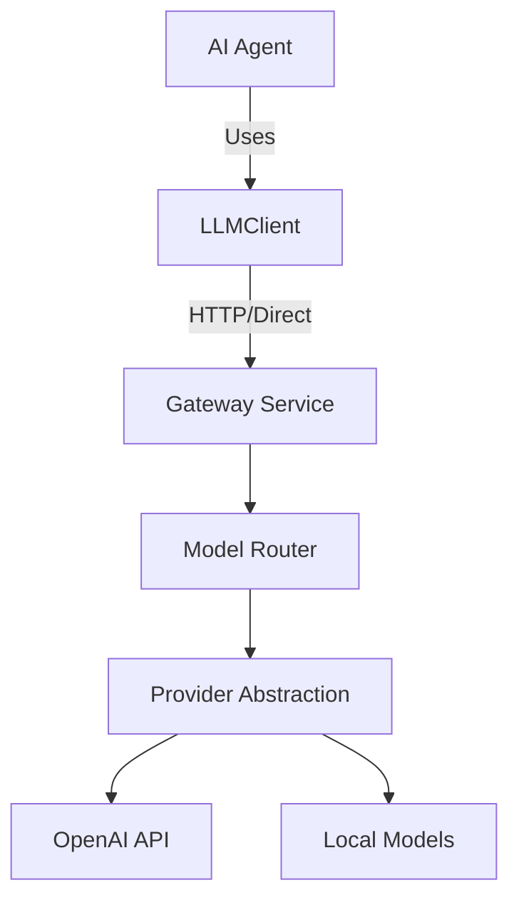

# Architecture

The AsuX LLM Gateway provides a unified interface for all AI agents to communicate with LLM providers.

## Core Flow

## Future Project Integration

Future AsuX projects (e.g., Prompt Engine, Agent Runtime) must NEVER depend directly on the OpenAI SDK. Instead, they will depend on the `LLMClient` provided by this project.

- **Project 1**: LLM Gateway V1 (This project)
- **Project 2**: Prompt Engine (Builds on this Gateway)
